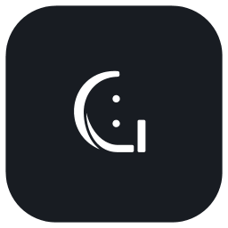
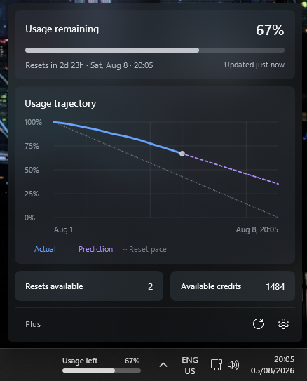

<p align="center">
  
</p>

<h1 align="center">Limit Lens</h1>

<p align="center">
  Your Codex and Claude limits, always visible.<br>
  A polished Windows taskbar companion with a glanceable usage bar and a focused forecast.
</p>

<p align="center">
  Windows 10/11 · Self-contained · Privacy-first · MIT licensed
</p>

<p align="center">
  Independent community project; not affiliated with or endorsed by OpenAI or Anthropic.
</p>

## Screenshot

<p align="center">
  
</p>

The screenshot was captured in isolated showcase mode with synthetic account
values. Showcase mode does not read local Codex sessions or write local app data.

## See your runway without breaking focus

Limit Lens places a compact percentage bar beside the Windows notification
area. Click it for the details that matter: how much usage remains, when the
window resets, and whether your current pace is likely to last.

No browser tab. No account page. No noisy dashboard.

## What you get

- **Usage remaining** — separate 5-hour and weekly taskbar bars for Plus;
  a weekly bar for Pro and higher-tier layouts, each with the percentage left
- **Claude limits** — Claude Pro and Max 5-hour and weekly limits beside Codex,
  read from Claude Code (see [Claude Code](#claude-code))
- **Your layout** — choose the limit in each of the two taskbar slots, which limit
  the prediction graph follows (or turn it off), and whether the flyout shows
  Codex, Claude, or both
- **Reset timing** — a live countdown plus the full reset date and time
- **Taskbar position** — move the whole widget with a saved slider in Settings;
  move all the way to either edge, and reset to beside the tray. Choose a free spot
  to avoid covering app buttons or tray icons.
- **Taskbar colours** — separate text and bar colours: Automatic, White, Black,
  Gray, or a custom `#RRGGBB` colour. Automatic bars retain low-usage colours.
  These preferences do not change the flyout.
- **Usage trajectory** — a smooth curve built from real recorded snapshots
- **Forecasting** — a recent-pace prediction alongside the sustainable reset pace
- **Credits** — optional available-credit and reset-credit cards when supplied
- **Freshness** — automatic refresh, stale-data visibility, and manual refresh
- **Alerts** — deduplicated warnings at 25%, 10%, and 0% remaining
- **Native behavior** — startup support, Explorer-restart recovery, tray access,
  light mode, and dark mode
- **Clay appearance** — warm ivory (Clay) and charcoal (Clay Dark) palettes with a
  clay accent and serif headings, beside the standard light and dark looks

## Designed to stay out of the way

The taskbar indicator answers the everyday question immediately. The flyout
opens only when requested and closes when focus moves elsewhere. Settings are
kept separate from the usage view, and optional account details disappear when
they are unavailable.

New installations start with sensible defaults:

- dark appearance;
- start with Windows;
- show available credits; and
- usage alerts enabled.

## Privacy by construction

Limit Lens reads supported account-limit data from `codex app-server` and
extracts a deliberately limited set of metadata from local Codex session logs.
It does not index or persist prompts, responses, command text, tool arguments,
workspace file contents, `auth.json`, or Codex-owned databases.

Account-wide values and this-device analytics stay separate. Read the complete
[privacy policy](PRIVACY.md).

## Claude Code

Claude Code reports your Claude Pro or Max usage to its status line. To show it
in Limit Lens, open Settings → Claude Code → **Connect**. Limit Lens becomes the
status-line command, keeps only the 5-hour and weekly percentages and reset
times, and runs your previous status line (if you had one) so Claude Code looks
the same. **Disconnect** restores your previous status line.

Connecting requires Git for Windows (Git Bash), which Claude Code uses to run
status-line commands when it is installed. Without it, Claude Code falls back to
PowerShell, which cannot run Limit Lens as a status line, and Settings says so.

Claude limits update whenever Claude Code renders its status line, which happens
after each reply. They appear after the first reply of a session and can be
older than Codex values while Claude Code is idle; the flyout shows when each
provider last updated. Limit Lens does not read Claude credentials or call any
Anthropic service.

## Download

Download the installer or portable ZIP from the
[latest GitHub release](../../releases/latest). Showcase packages are for
maintainer testing and are not end-user release assets.

### Installer

The recommended per-user installer requires no administrator access. It adds
Limit Lens to the Start Menu and provides a normal uninstall entry.

Version 0.2.0 is not code-signed, so Windows may display a Microsoft Defender
SmartScreen warning. Verify the download against the release's
`SHA256SUMS.txt` before running it.

### Portable

The portable ZIP contains a self-contained `win-x64` build. Extract it and run
`LimitLens.exe`. The included `portable.flag` keeps settings and aggregates in
the neighboring `Data` directory.

The application does not require a separately installed .NET runtime.

### Verify a download

Run the following and compare the resulting hash with the matching line in
`SHA256SUMS.txt`:

```powershell
Get-FileHash .\LimitLens-Setup-0.2.0-win-x64.exe -Algorithm SHA256
```

## Requirements

- Windows 10 version 2004 or newer, or Windows 11
- x64 processor
- Codex installed for account-level limits
- Claude Code with a Claude Pro or Max subscription for Claude limits (optional)

Local analytics remain available while account data is offline or unavailable.

Limit windows are identified by the durations returned by Codex, rather than
their primary/secondary position. Plus shows both windows in the flyout as well
as the taskbar; the chart prefers the weekly window when it is available.
Missing values display “—” instead of a full allowance. Hover over the taskbar
indicator to see each window's reset countdown and data freshness.

The compact weekly-only layout is also used for Business, Enterprise, and Edu.
This is a display preference, not a statement that those plans have no other
limits. Their actual entitlements can vary, and alerts still evaluate all
returned windows. See the [official usage-limit documentation](https://learn.chatgpt.com/docs/pricing#what-are-the-usage-limits-for-my-plan).

## Build from source

Install the .NET SDK version specified in `global.json`, then run:

```powershell
dotnet restore LimitLens.slnx --locked-mode -p:Configuration=Release
dotnet build LimitLens.slnx -c Release --no-restore
dotnet test LimitLens.slnx -c Release --no-build --no-restore
```

Create the installer and portable ZIP with:

```powershell
./scripts/build-release.ps1 -Version 0.2.0
```

Pass `-SkipInstaller` when Inno Setup 6 is not installed.

Maintainers can additionally create the isolated, synthetic showcase package
for screenshot testing. It must not be attached to a public release:

```powershell
./scripts/build-release.ps1 -Version 0.2.0 -SkipInstaller -IncludeShowcase
```

## Data locations

| Mode | Location |
|---|---|
| Installed | `%LOCALAPPDATA%\LimitLens` |
| Portable | `Data` beside `LimitLens.exe` |
| Codex input | `%CODEX_HOME%` or `%USERPROFILE%\.codex` |
| Claude limits | `claude-usage.json` in the Limit Lens data folder |
| Claude Code settings (Connect only) | `%CLAUDE_CONFIG_DIR%` or `%USERPROFILE%\.claude\settings.json` |

Limit Lens never modifies the Codex home directory.

## License

[MIT](LICENSE)
